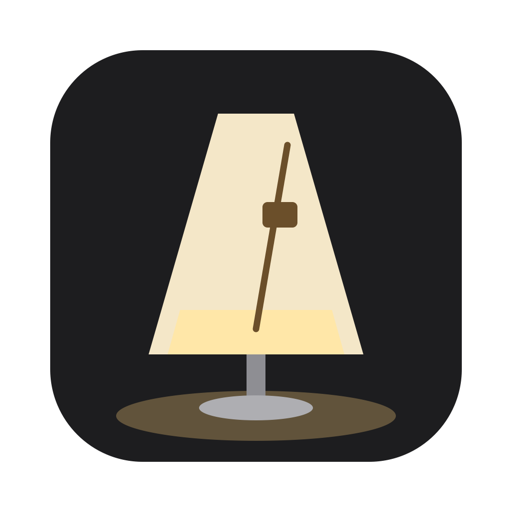
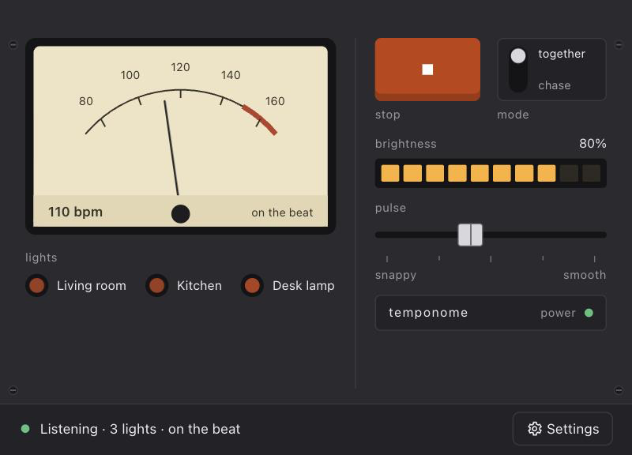
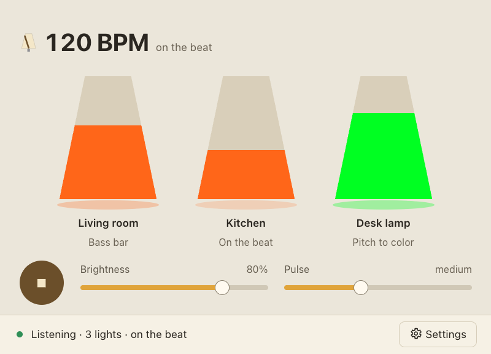
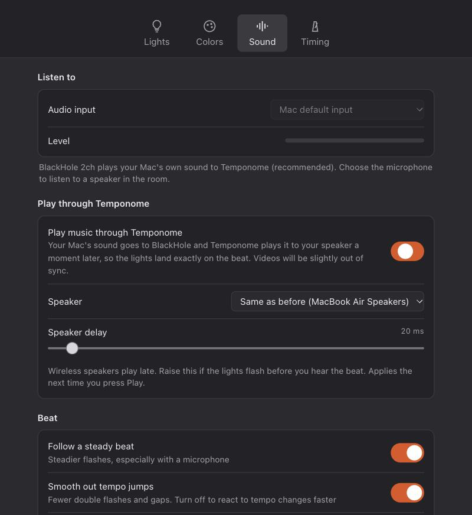

  

<h1 align="center">Temponome</h1>

<b>Your lights, in time with your music.</b> 
A free Mac app that makes Tapo and Govee lights pulse, flash and change color to whatever you're playing.

  <a href="https://github.com/petroskon18/temponome/releases/latest"><b>⬇ Download for Mac</b></a>
  &nbsp;·&nbsp; Apple silicon &nbsp;·&nbsp; Free and open source

  
  

## What it does

Play music on your Mac (Spotify, Apple Music, YouTube, anything) and press **Play** in Temponome. It listens, finds the beat, and your lights follow along:

- 💡 **Flash on every beat**, brighter or in a new color.
- 🥁 **Follow one drum.** One lamp thumps with the kick, another flickers with the hi-hats.
- 📊 **Work like an equalizer.** Three lights become bass, middle and treble bars.
- 🌈 **Turn the music into color.** Red for deep bass, green for voices and guitars, blue for cymbals.
- 🎯 **Land exactly on the beat**, even on wireless speakers, with a quick camera calibration.
- 🎚 **Presets.** Save a whole look as "Party" or "Chill" and switch with one click.
- ▶️ **Start by itself** when Spotify or Music starts playing (if you switch it on).

The window is a little stage of lamps: each of your lights is drawn as a lamp shade that glows just like the real one, and the tempo ticks along at the top.

## What you need

| | |
|---|---|
| **A Mac with Apple silicon** (M1 or newer) | |
| **Lights on the same Wi-Fi** | TP-Link **Tapo** color bulbs (tested with the L530) and **Govee** lamps with *LAN Control* switched on in the Govee Home app (tested with the H6052 table lamp) |
| **BlackHole 2ch** (free) | Lets Temponome hear your Mac's sound. Get it from [existential.audio/blackhole](https://existential.audio/blackhole/). You can use the Mac's microphone instead, but it's less precise. |

## Get started

1. **Download** `Temponome.dmg` from the [latest release](https://github.com/petroskon18/temponome/releases/latest), open it and drag **Temponome** into **Applications**.
2. **Open it the first time** with a right-click on Temponome → **Open**, then **Open** again. macOS asks this once because the app isn't signed with a paid Apple developer account.
3. **Find your lights.** Open **Settings** (⌘, or the gear) → **Lights** and press **Find my lights**. Tapo bulbs need your Tapo account sign-in, which stays on your Mac.
4. **Press Play** and put on a song.

A short welcome guide walks you through these steps the first time.

**Brightness**, **Pulse** and your **Preset** are right on the main window. **Stop** puts every light back the way it was before you pressed Play. Closing the window keeps Temponome running behind a little lamp in the menu bar, with Play/Stop and your presets; choose **Quit** there to close it completely.

## Make it yours

| Lights | Colors | Timing |
|---|---|---|
|  |  |  |
| Choose what each light follows. | Pick your colors and the extras. | Line the flashes up with the beat. |

### What each light can follow

| Choice | What you'll see |
|---|---|
| **On the beat** | A flash on every beat. With two or more of these, choose on the main window whether they flash **Together** or take turns (**Chase**). |
| **Kick, Snare or Hi-hats** | Only that drum. The snare choice can also catch guitar or voice, which sit in the same range. |
| **Bass, Middle or Treble level** | The light grows brighter as that part of the sound gets louder, like one bar of an equalizer. |
| **Pitch to color** | Red when the bass takes over, green for voices and guitars, blue for cymbals. Brightness follows the loudness. |

### Presets

Save the look you have (colors, extras, brightness, pulse and what each light follows) in **Settings → Colors → Presets**, then switch between looks from the main window or the menu bar. *Party* and *Chill* are there to start with.

### Start by itself

In **Settings → Sound**, switch on **Start when a music app plays**. Temponome then presses Play for you a moment after Music, Spotify, TIDAL, Deezer or Amazon Music starts playing (you can add other apps). It never stops by itself, so press Stop when you're done. Videos in a browser and calls don't count.

### Colors and extras

In **Settings → Colors**, choose whether each beat makes the lights **brighter** or makes them **jump from your calm color to your energetic one**. Pick white in the middle of the color wheel and a slider lets you make it **warm or cool**, using the bulbs' own white light. Then switch on any of these:

- **Stronger first beat.** Beat 1 of each bar flashes full and the others softer, so you can feel where each bar starts.
- **Turn the colors around the wheel.** Every 4 or 8 bars both colors move a step, so a long song keeps changing.
- **Build-ups and drops.** When the drums drop out the lights dim and rise with the music, then burst to full when the beat comes back.

## Lights exactly on the beat

Normally Temponome has to *guess* when the next beat will land. Turn on **Play music through Temponome** (Settings → Sound) and it plays your sound to the speaker itself, about a third of a second late. Because it hears every hit before you do, each flash lands at the moment you hear it.

- Pick your speaker, or leave it on *Same as before*.
- Wireless speakers play late. If the lights flash before you hear the beat, raise that speaker's **Speaker delay**.
- Your volume keys keep working, and **Stop** puts your speaker back.
- Videos will be slightly out of sync while it's on, so switch it off for movies.
- It needs BlackHole (not the microphone).

Every light also has its own small delay. **Settings → Timing** measures it with your Mac's camera, so flashes don't trail behind the music.

 

## Questions

**macOS says the app "can't be opened" or is from an unidentified developer.**
Right-click the app → **Open** → **Open**. You only need to do this once.

**My Govee lamp isn't found.**
In the Govee Home app, open the lamp's settings and switch on **LAN Control**. The lamp and the Mac must be on the same Wi-Fi.

**The lights react, but not to my music.**
In **Settings → Sound**, choose **BlackHole 2ch** as the input. If your Mac's sound doesn't reach BlackHole, turn on **Play music through Temponome**, which sets this up for you.

**There are double flashes or gaps.**
Temponome smooths out sudden tempo jumps by default (**Smooth out tempo jumps** in Settings → Sound). For the tightest timing, use *Play music through Temponome*.

**Where are my settings kept?**
On your Mac only, in `~/Library/Application Support/Temponome/`. Nothing is sent anywhere except to your own lights.

## For developers

Temponome is a Python engine with a small web interface in a native window (pywebview), packaged with PyInstaller.

- Run the tests: `python3 -m unittest tests.test_temponome` and `python3 tests/simulate.py` (needs numpy and scipy).
- Build the disk image: `build/build_dmg.sh` → `dist/Temponome.dmg`.
- Run without building: double-click `Start Tapo Music.command` (needs Python; don't run it at the same time as the app).
- Project notes for Claude Code are in [`CLAUDE.md`](CLAUDE.md).

## License

Free software under the [GNU General Public License v3.0](LICENSE).
