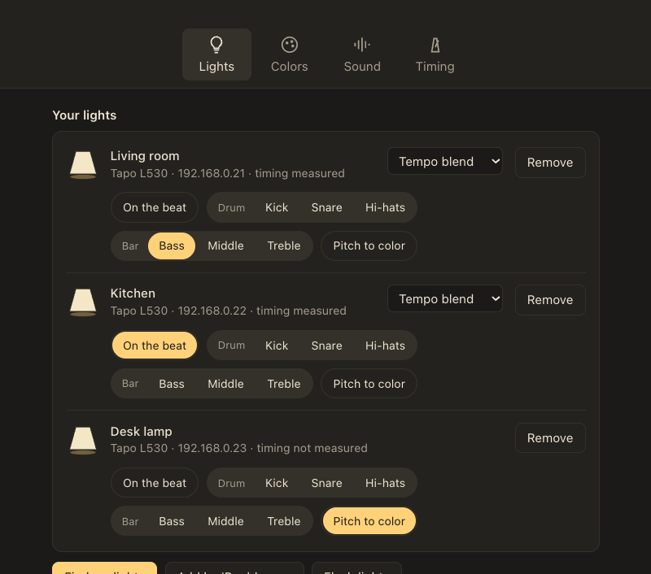
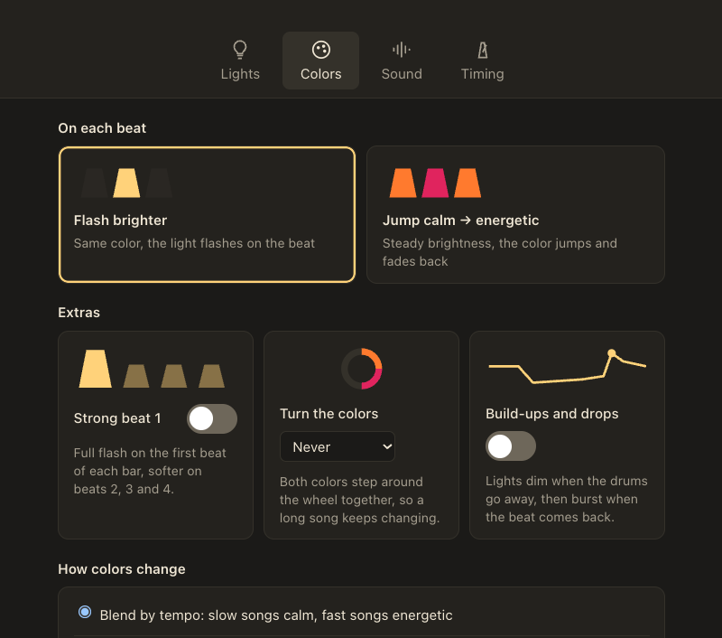
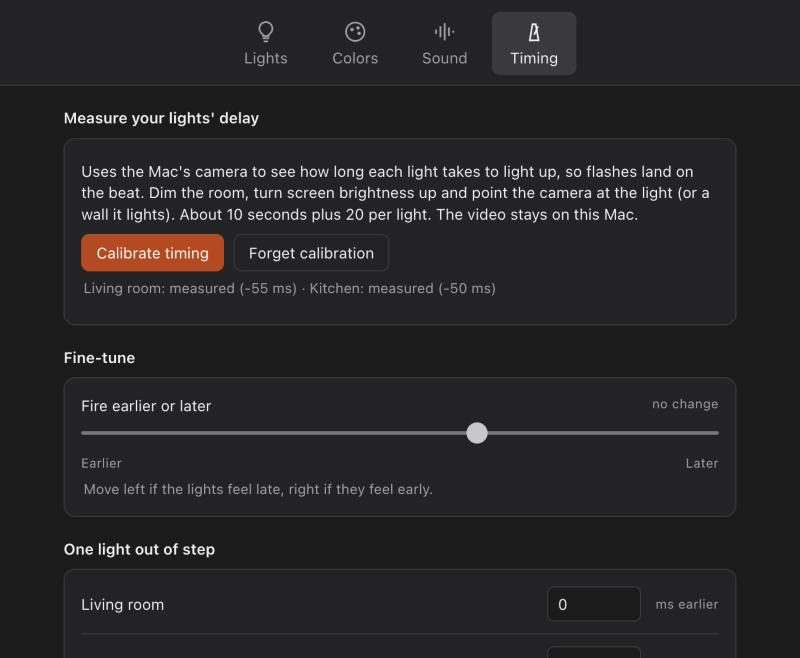

# Temponome

Makes your Tapo and Govee lights pulse and change color with your music, on a Mac.

  
  

The main window looks like a small piece of studio gear. Press Play: the meter's needle points at the song's tempo and kicks on every beat, and each of your lights has its own lamp glowing in the color it is showing.

## Install
1. Download **Temponome.dmg** from the [latest release](https://github.com/petroskon18/temponome/releases/latest) (Apple silicon Macs), open it and drag **Temponome** onto the **Applications** folder (choose Replace if asked).
2. The first time: open Applications, **right-click Temponome → Open**, then Open again. (macOS asks this because the app isn't signed with an Apple developer account.)
3. For your Mac's own sound, install **BlackHole 2ch** (free) from https://existential.audio/blackhole/. You can use the Mac's microphone instead.

## Use
- Press **Play**. The meter shows the tempo and kicks on each beat, and each lamp glows in the color its light is showing.
- **Brightness** and **Pulse** are on the main window. Everything else is in **Settings** (⌘, or the gear): find your lights, colors, sound input, and timing calibration with the camera.
- **Stop** puts each light back the way it looked before you pressed Play.
- Your lights, colors and timing from the old version carry over automatically. Settings live in `~/Library/Application Support/Temponome/`.

## Ways the lights can react

- **Brightness or color.** In Settings → Colors, choose what each beat changes. *Brightness* flashes the lights brighter. *Color* keeps them at a steady brightness and makes them jump from your calm color to your energetic one on every beat, then fade back.
- **One drum per light.** In Settings → Lights, each light can follow the beat, or just one drum: the **kick**, the **snare** or the **hi-hats**. For example, one lamp can thump with the kick while another flickers with the hi-hats. The snare choice may also catch guitar or voice, which sit in the same range. Drums land best with *Play music through Temponome* on (below).
- **Together or Chase.** On the main window, lights that follow the beat can flash together or take turns.
- **Extras** (Settings → Colors):
  - **Stronger flash on the first beat of each bar.** Beat 1 flashes full and beats 2–4 flash softer, so you can feel where each bar starts.
  - **Turn the colors around the wheel.** Every 4 or 8 bars, both of your colors move a step around the color wheel, so a long song keeps changing.
  - **Build-ups and drops.** When the drums go away (a breakdown), the lights dim and rise with the music. When the beat comes back, every light bursts to full and fades slowly.

## Lights exactly on the beat

Turn on **Play music through Temponome** in Settings → Sound. Temponome then plays your Mac's sound to your speaker itself, about 0.3 seconds late. Because it hears every drum hit before you do, it can make each light flash at the moment you hear the hit, instead of guessing where the next beat will be.

- Pick a speaker, or leave it on "Same as before". Wireless speakers play late: if the lights flash before you hear the beat, raise that speaker's **Speaker delay**.
- Your volume keys keep working.
- **Stop** puts your speaker and its volume back. If Temponome ever quits unexpectedly, it fixes this the next time it opens.
- Videos will be slightly out of sync while it's on, so turn it off when you watch videos.
- It needs BlackHole 2ch. It doesn't work with the microphone, because sound in the room has already been heard.

Even with it off, Temponome now keeps a steadier beat: it ignores brief jumps in the tempo and slides onto the beat instead of jumping, so there are far fewer double flashes and gaps. You can switch this off with **Smooth out tempo jumps**.

## Settings

| Lights | Colors | Timing |
|---|---|---|
|  |  |  |
| Find your lights on Wi-Fi, pick which to use, and choose what each one reacts to. | Choose whether a beat changes brightness or color, and pick a calm and an energetic color on the wheel; Preview shows it on your lights. With Brightness, a strip shows the color at every tempo. | Measure each light's delay with the Mac's camera, so flashes land on the beat. |

| Sound |   |
|---|---|
|  | Choose what Temponome listens to, turn on **Play music through Temponome** with your speaker and its delay, and set how the beat is followed. |

## Older way to run it
Double-click `Start Tapo Music.command` (needs Python). Don't run it at the same time as the app.

## For developers
- Tests: `python3 -m unittest tests.test_temponome` and `python3 tests/simulate.py` (needs numpy, scipy).
- Build the disk image: `build/build_dmg.sh` → `dist/Temponome.dmg`.
- Project notes for Claude Code are in `CLAUDE.md`.

## License

Temponome is free software under the GNU General Public License v3.0. See [LICENSE](LICENSE).
